 

  
  
  
  

---

## 👨‍💻 About Me

I'm a passionate **Full-Stack Developer** specializing in building responsive, scalable and user-friendly web applications with modern technologies.

- 💻 Professional experience in **MERN Stack** development
- ⚛️ Frontend development with **React.js** and **JavaScript**
- 🔧 Backend development with **Node.js** and **Express.js**
- 🗄️ Database management with **MongoDB** and **SQL**
- 🤖 Exploring **AI, NLP, RAG and LLM** technologies
- 🐳 Learning **Docker, AWS** and **System Design**
- 🎯 Goal: build scalable and intelligent applications

---

## 🛠️ Tech Stack

| Area | Technologies |
|---|---|
| **Frontend** |  |
| **Backend** |  |
| **Database** |  |
| **Tools & DevOps** |  |
| **AI & NLP** |     |

---

## 🚀 Featured Projects

<!-- TODO: replace each "View Project" link with the real repo URL, e.g. https://github.com/07dhilipkumar02/ai-resume-analyzer -->

<table>
<tr>
<td width="50%" valign="top">

### 🤖 AI Resume Analyzer
An intelligent resume analyzer that evaluates resumes, generates ATS scores, extracts skills and recommends matching jobs.

**Key features**
- 📄 Resume parsing and analysis
- 🎯 ATS score generation
- 🔍 Skill extraction
- 💼 Job recommendations
- 🧠 RAG and vector-based retrieval

**Tech:** `React` `Node.js` `Express` `MongoDB` `NLP` `RAG`

🔗 [**View Project →**](https://github.com/07dhilipkumar02?tab=repositories)

</td>
<td width="50%" valign="top">

### 🛒 E-Commerce Web Application
A full-stack shopping platform with authentication, product management, search, cart and REST API integration.

**Key features**
- 🔐 User authentication (JWT)
- 📦 Product management
- 🛍️ Shopping cart
- 🔎 Product search
- 🔗 REST API integration

**Tech:** `React` `Node.js` `Express` `MongoDB` `JWT`

🔗 [**View Project →**](https://github.com/07dhilipkumar02?tab=repositories)

</td>
</tr>
<tr>
<td width="50%" valign="top">

### 🍕 Food Ordering Application
A food ordering platform with authentication, cart management and frontend–backend API integration.

**Key features**
- 🍔 Food browsing
- 🛒 Cart management
- 🔐 User authentication
- 🔗 API integration

**Tech:** `React` `Node.js` `Express` `MongoDB`

🔗 [**View Project →**](https://github.com/07dhilipkumar02?tab=repositories)

</td>
<td width="50%" valign="top">

### 💬 AI Chatbot
An intelligent chatbot that processes natural-language queries using a Python backend.

**Key features**
- 🤖 Natural language processing
- 💬 Intelligent conversations
- 🐍 Python backend integration
- 🧠 AI-powered responses

**Tech:** `React` `Python` `Node.js` `NLP` `LLM`

🔗 [**View Project →**](https://github.com/07dhilipkumar02?tab=repositories)

</td>
</tr>
</table>

---

## 💼 Professional Experience

### 🟢 Full Stack Developer — TechB Software Solutions
`Jan 2026 – Present`
- Develop and maintain MERN stack applications
- Build responsive interfaces using React.js and JavaScript
- Develop and integrate RESTful APIs
- Manage MongoDB database operations
- Debug and optimize application performance
- Collaborate with development teams using Git and GitHub

### 🔵 Full Stack Developer — Sukhibhavan Properties
`2022 – 2024`
- Developed responsive web applications using React.js and Node.js
- Integrated frontend and backend using REST APIs
- Designed and managed MongoDB databases
- Implemented features and resolved application bugs
- Supported application deployment and maintenance

### 🟠 Marketing Executive — Harika Pharma & Surgical Distributors
`2020 – 2022`
- Managed customer interactions and business communications
- Developed analytical and problem-solving skills
- Assisted with business reporting and process improvements

---

## 🏆 Achievements

- 🚀 Built 4+ full-stack application projects
- 🤖 Developed an AI-powered Resume Analyzer
- 🔗 Integrated REST APIs and database solutions
- 💻 Experienced in both frontend and backend development
- 📈 Continuously learning modern development technologies

---

## 📜 Certifications

| Certification | Issued by |
|---|---|
| ✅ MERN Stack | Entri Elevate (NSDC) |
| ✅ MERN Stack | Illinois Tech |
| ✅ JavaScript & Python | GUVI |
| ✅ AI for All | NASSCOM |
| ✅ Machine Learning & Deep Learning | — |

---

## 🎓 Education

**Bachelor of Engineering — Electrical and Electronics Engineering**
Anna University · `2012 – 2016`

---

## 🌐 Connect With Me

  
  
  
  

  <i>"Code is like humor. When you have to explain it, it's bad." — Cory House</i>  
  ⭐ Thanks for visiting my GitHub profile! Let's connect and build something amazing. 🚀

