  

  
  
  
  
  

<!-- TODO: replace each project link with the real repo URL, e.g. https://github.com/07dhilipkumar02/ai-resume-analyzer -->

  
  

  
  

  
  

  <i>"Code is like humor. When you have to explain it, it's bad." — Cory House</i> 
   ❤️Thanks for visiting! Let's connect and build something amazing. 💕

